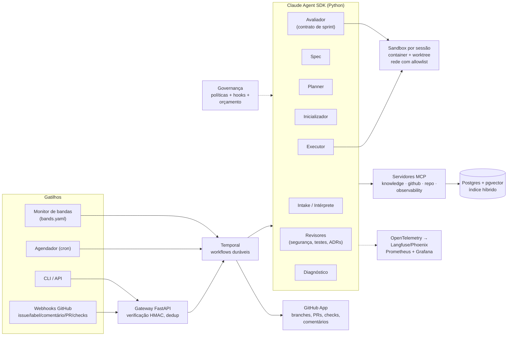
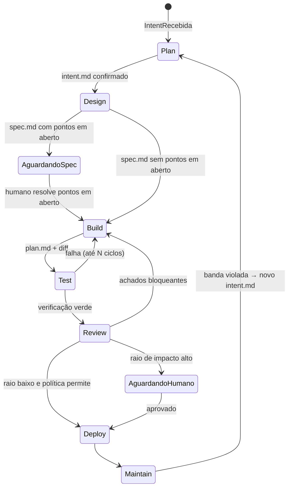
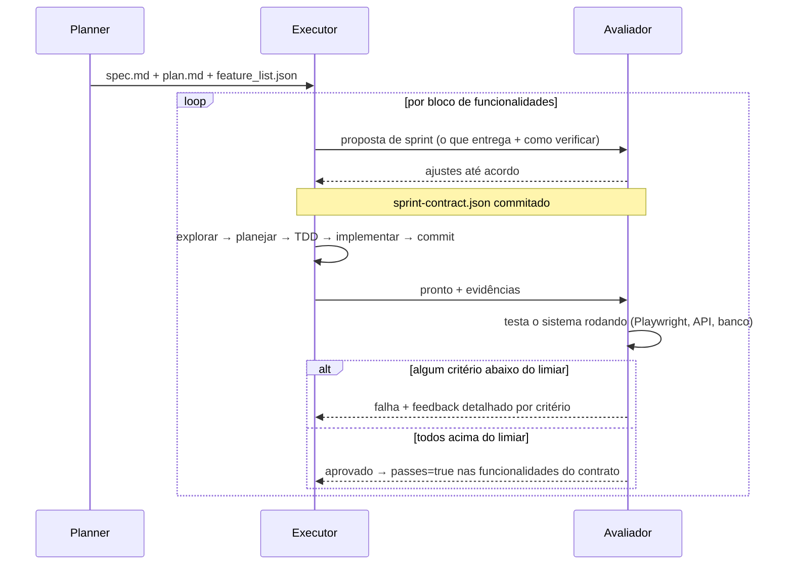

# Design Doc — Forja: Harness Autônomo de Engenharia com RAG (Python)

- id: agent-harness
- Status: Proposto
- Linguagem: Python 3.12
- Arquitetura: Clean Architecture + Hexagonal + DDD; workflows duráveis; políticas como código
- Referências de método (Anthropic): AI-native SDLC (Applied AI, 2026); Effective harnesses for long-running agents (nov/2025); Harness design for long-running application development; Building effective agents; Effective context engineering for AI agents; context editing e memory tool; Writing effective tools for agents; Introducing advanced tool use (tool search, programmatic tool calling, tool use examples); Code execution with MCP; Equipping agents for the real world with Agent Skills; Introducing Contextual Retrieval; How we built our multi-agent research system; Demystifying evals for AI agents; Beyond permission prompts (sandboxing); Claude Code best practices; Claude Agent SDK (Python)

## 1. Problema

Agentes de código já escrevem código mais rápido do que pessoas conseguem planejar, revisar e implantar. O gargalo mudou de lugar: agora está em transformar intenção em especificação, verificar continuamente, revisar com critério de risco e observar produção. Rodar um agente numa sessão de terminal não resolve isso: ele perde o contexto entre sessões, declara vitória cedo, não tem memória do projeto e não sabe quando parar para pedir aprovação.

A Forja é um harness: a infraestrutura em volta do modelo que dá a ele memória de projeto (RAG), ciclo de trabalho (SDLC), ferramentas, limites, gatilhos e observabilidade, para que agentes trabalhem com o máximo de autonomia segura sobre repositórios reais no GitHub.

## 2. Objetivos e não-objetivos

Objetivos

- Implementar o AI-native SDLC como pipeline de artefatos versionados: intent.md → spec.md → plan.md → diff + testes → PR com review.md → deploy → monitoramento por bands.yaml → novo intent.md.
- Implementar o harness de longa duração: agente inicializador + agente de execução, feature_list.json, arquivo de progresso, init.sh, uma funcionalidade por sessão.
- RAG de engenharia: código, ADRs, design docs, issues, PRs, incidentes e catálogo de cursos, com recuperação híbrida e atualização incremental por webhook.
- Ativação autônoma de agentes por eventos (GitHub, cron, violação de banda, CLI), com workflows duráveis que sobrevivem a falhas e esperam aprovação humana.
- Governança por raio de impacto: o que pode ser auto-mergeado, o que exige humano, aplicado por hooks no momento da ação.
- Observabilidade e evals contínuos do próprio harness: custo, sucesso, regressões de qualidade.
- Ser o motor do Construtor do agente de posicionamento e do modo noturno do Claude Code.

Não-objetivos

- Ser um produto multiusuário ou SaaS na v1 (um dono, vários repositórios).
- Substituir revisão humana em código de alto risco (auth, pagamentos, migrações, infraestrutura).
- Treinar ou ajustar modelos (fine-tuning fica fora).

## 3. Princípios (derivados das referências)

| Princípio | Como aparece no projeto |
| --- | --- |
| Gargalo está no planejamento, revisão e deploy, não no código | Pipeline de artefatos com portões em spec e em PR de alto risco |
| Cada etapa commita um artefato que a próxima lê | intent.md, spec.md, plan.md, review.md, bands.yaml versionados no repositório-alvo |
| A cadeia de commits é a trilha de auditoria | Commits assinados pelo GitHub App, com trailers Intent-Id, Run-Id, Approved-By |
| Agentes trabalham em turnos sem memória; continuidade em artefatos, não no contexto | feature_list.json, progress.md, git log, init.sh lidos no início de toda sessão |
| Uma funcionalidade por sessão; só marcar como passando após teste de ponta a ponta | Executor só pode mudar o campo passes; editar ou remover testes é bloqueado por hook |
| Comece pelo padrão mais simples (workflow) e só use agente onde precisa | Roteamento e etapas fixas são workflows; agentes só onde há exploração |
| Contexto é recurso finito | Subagentes com contexto isolado, recuperação sob demanda, compactação e notas estruturadas |
| Ferramentas desenhadas para agentes | Namespacing, respostas enxutas e com significado, descrições tratadas como prompt |
| Governança aplicada enquanto o agente age | Hooks PreToolUse como portões; permissões por etapa; sandbox |
| Evals contínuos, não fase final | Graders de código, de modelo e humanos; suíte de regressão rodando no CI |
| Cada componente do harness é uma hipótese sobre o que o modelo não faz sozinho | Ablação periódica: desligar componentes um a um e medir nos evals; remover o que não sustenta resultado |

## 3A. Metodologias complementares da Anthropic aplicadas à entrega

Além do AI-native SDLC e do harness de longa duração, o projeto incorpora as práticas abaixo. Cada linha diz o que muda na Forja e qual métrica prova o ganho.

| Metodologia | O que a Forja implementa | Métrica de ganho |
| --- | --- | --- |
| Planejador + Gerador + Avaliador (Harness design for long-running application development) | Três papéis separados no Build: o Planner expande a intenção em spec de produto; o Executor gera; um Avaliador independente testa o sistema rodando como usuário (Playwright para UI, chamadas reais para API, consultas ao banco). Avaliar fora do gerador é mais fácil de calibrar do que tornar o gerador crítico do próprio trabalho | % de defeitos pegos antes do PR; ciclos até verde |
| Contrato de sprint (mesma fonte) | Antes de cada bloco de funcionalidades, Executor propõe o que vai entregar e como será verificado; o Avaliador revisa até haver acordo. O contrato (sprint-contract.json) vira critério testável e é commitado | Divergência entre "pronto" declarado e "pronto" verificado |
| Critérios com limiar rígido (mesma fonte) | O Avaliador pontua por critério (funcionalidade, profundidade, qualidade de código, aderência a ADRs); abaixo do limiar em qualquer um, o bloco falha com feedback detalhado. Avaliador calibrado com exemplos few-shot pontuados | Variância das notas entre execuções |
| Reset de contexto vs. compactação (mesma fonte + context management) | Estratégia configurável por modelo: compactação automática numa sessão contínua, ou reset completo com handoff estruturado (progress.md, contrato, git log) quando o modelo mostrar tendência a encerrar cedo perto do limite | Taxa de sessões encerradas antes de concluir o contrato |
| Context editing + memory tool (Managing context on the Claude Developer Platform) | Limpeza automática de resultados de ferramentas antigos durante sessões longas; memória por repositório (/memories/<repo>/: convenções, armadilhas, comandos que funcionam), armazenada pela Forja e consultada no início de cada sessão | Tokens por funcionalidade entregue; erros repetidos entre sessões |
| Contextual Retrieval (Introducing Contextual Retrieval) | Cada trecho recebe um prefixo de contexto gerado por modelo antes de ir para o embedding e para o índice BM25; busca híbrida + reranking; geração dos prefixos com prompt caching do documento inteiro para baratear | recall@20 e taxa de recuperações falhas no eval de RAG |
| Agent Skills com divulgação progressiva (Equipping agents… with Agent Skills) | Procedimentos da organização viram skills em .forja/skills/ (escrever spec, escrever ADR, revisar segurança, criar migração segura, preparar release). Só nome e descrição ficam no contexto; o corpo e os scripts carregam quando a tarefa pede | Tokens fixos por sessão; aderência aos procedimentos nos evals |
| Tool search, programmatic tool calling e tool use examples (Introducing advanced tool use) | Ferramentas MCP com carregamento sob demanda (o agente busca a ferramenta em vez de receber todas); consultas em lote ao GitHub e à observabilidade orquestradas por código, devolvendo só o resumo; exemplos de uso nas ferramentas com parâmetros complexos | Tokens de definição de ferramentas por turno; erros de parâmetro |
| Code execution com MCP (Code execution with MCP) | No sandbox, servidores MCP também ficam expostos como API de código; o agente escreve um script que chama várias ferramentas, filtra os dados no ambiente de execução e só devolve o necessário ao modelo | Tokens de resultados intermediários por tarefa |
| Sandboxing de sistema de arquivos e rede (Beyond permission prompts) | Dentro do sandbox, comandos rodam sem pedir permissão (autonomia); fora dele, nada. Isolamento de arquivos e de rede ao mesmo tempo, com o runtime de sandbox da Anthropic (bubblewrap no Linux) ou container rootless + proxy de saída | Pedidos de aprovação por entrega; tentativas bloqueadas |
| Sistema multiagente orquestrador-trabalhadores (How we built our multi-agent research system) | Pesquisa de spec e diagnóstico de incidente usam um agente líder que dispara subagentes em paralelo (código, ADRs, PRs, incidentes, métricas) e um passo final de citação. Usado só onde a tarefa é ampla e paralelizável, porque multiagente gasta bem mais tokens | Qualidade da spec (rubrica) vs. custo |
| Evals de agente (Demystifying evals for AI agents) | Tarefas, tentativas, transcrições e resultado verificado no ambiente (não o que o agente diz); evals de capacidade (começam baixos) e de regressão (perto de 100%); pass@k e pass^k; 20–50 tarefas iniciais tiradas de falhas reais; ambiente limpo por tentativa; leitura de transcrições | pass^k nas tarefas de regressão; tempo até detectar regressão |
| Melhores práticas do Claude Code | Dentro do Executor: explorar → planejar → codar → commitar; TDD (testes commitados antes do código); evidência em vez de afirmação (saída de testes, comandos e capturas anexadas ao PR); para issues difíceis, 2 implementações concorrentes em worktrees e o Avaliador escolhe | % de PRs com evidência completa; taxa de aceitação |
| Building effective agents | Começar pelo workflow mais simples; agente só onde há exploração real (já aplicado na seção 5.4) | Custo por intenção vs. sucesso |
| Writing effective tools for agents | Ferramentas avaliadas com tarefas reais de vários passos, não chamadas isoladas; descrições revisadas a partir das transcrições | Taxa de uso correto de ferramenta |

## 4. Arquitetura

### 4.1 Contextos delimitados (DDD)

| Contexto | Responsabilidade | Agregados | Eventos |
| --- | --- | --- | --- |
| Intake | Receber intenções de qualquer origem e normalizar em Intent | Intent, Origem | IntentRecebida, IntentConfirmada |
| Knowledge | Indexar e recuperar conhecimento de engenharia (RAG) | Corpus, Documento, Trecho | DocumentoIndexado, IndiceAtualizado |
| Delivery (SDLC) | Conduzir a intenção pelas etapas até o PR | Entrega (estado da máquina SDLC), Artefato | SpecPronta, PlanoPronto, PRAberto, EntregaConcluida |
| Execution | Sessões de agente em sandbox, harness de longa duração | Sessao, Sandbox, FeatureList | SessaoIniciada, FeatureAprovada, SessaoEncerrada |
| Governance | Políticas, raio de impacto, aprovações, orçamento | Politica, Aprovacao, Orcamento | AprovacaoSolicitada, AprovacaoConcedida, AcaoBloqueada |
| Operations | Bandas de produção, incidentes, diagnóstico | Banda, Incidente | BandaViolada, IncidenteDiagnosticado |
| Evaluation | Suítes de avaliação, graders, histórico de qualidade | Suite, Execucao, Resultado | EvalConcluida, RegressaoDetectada |

### 4.2 Visão geral



### 4.3 Stack

| Camada | Escolha | Motivo |
| --- | --- | --- |
| Agentes | claude-agent-sdk (Python) | Loop de agente, ferramentas, hooks, subagentes, MCP e permissões prontos |
| Chamadas diretas ao modelo | anthropic SDK | Workflows simples (roteamento, classificação) sem o loop completo |
| Workflows | Temporal (Python SDK) | Execuções longas, retentativas, timers e sinais humanos (aprovação) duráveis |
| API e webhooks | FastAPI + Pydantic v2 | Tipagem forte, validação de payloads |
| Dados | PostgreSQL 16 + pgvector + busca textual nativa | Um banco para estado, vetores e BM25 |
| Fila leve e cache | Redis | Rate limit, deduplicação de eventos |
| Parsing de código | tree-sitter | Chunking por função, classe e módulo |
| Sandbox | Docker rootless (gVisor opcional) + git worktree | Isolamento por sessão |
| Observabilidade | OpenTelemetry, Langfuse ou Phoenix (self-hosted), Prometheus, Grafana | Traces de LLM e métricas do harness |
| Qualidade | uv, ruff, pyright, pytest, hypothesis, testcontainers | Padrão moderno de Python |
| Entrega | Docker, GitHub Actions, Helm (opcional) | Mesmo padrão dos outros projetos |

### 4.4 Estrutura hexagonal

```text
forja/
  domain/            # Intent, Entrega (máquina de estados), Politica, Banda... (Python puro)
  application/       # casos de uso e portas (Protocols)
  infrastructure/
    agents/          # adaptadores do Claude Agent SDK, prompts, subagentes
    github/          # GitHub App (ACL do GitHub)
    knowledge/       # indexadores, chunkers, retrievers
    sandbox/         # Docker, worktrees
    temporal/        # workflows e activities
    telemetry/
  interfaces/
    http/            # FastAPI (webhooks, API, painel)
    cli/             # Typer
    mcp/             # servidores MCP próprios
```

Anti-Corruption Layer: o GitHub (payloads de webhook, REST e GraphQL), o Claude Agent SDK (tipos de mensagem) e os backends de observabilidade ficam atrás de tradutores. O domínio fala em Intent, Entrega, Aprovacao, nunca em IssueCommentEvent ou ResultMessage.

## 5. O pipeline AI-native SDLC

### 5.1 Máquina de estados da entrega



### 5.2 Artefatos por etapa

| Etapa | Agente | Artefato | Conteúdo mínimo | Portão |
| --- | --- | --- | --- | --- |
| Plan | Intérprete | intent.md | Problema nas palavras de quem pediu, origem, critérios de sucesso declarados, link da issue | Quem pediu confirma o resumo (comentário /confirm ou reação) |
| Design | Spec (orquestrador + subagentes de pesquisa no RAG) | spec.md | Requisitos, restrições, critérios de aceite em Gherkin, ADRs afetados, pontos em aberto marcados | Humano resolve pontos em aberto antes do Build |
| Build | Planner → Inicializador → Executor | plan.md, feature_list.json, progress.md, init.sh, diff | Arquivos a mudar, ordem, testes que confirmam cada passo | Nenhum; verificação contínua |
| Test | Executor + graders | resultados no progress.md e checks do PR | Testes unitários, integração, E2E (navegador automatizado quando há UI) | Tudo verde |
| Deploy | Revisores | PR com review.md | Achados por revisor (segurança, testes, aderência a ADRs, desempenho), classificação de risco | Humano se o raio de impacto exigir; auto-merge só em risco baixo |
| Maintain | Diagnóstico | bands.yaml (configuração), incident.md → intent.md | Banda violada, evidência, hipótese, proposta | Novo ciclo começa no Plan |

Todos os artefatos ficam em .forja/<intent-id>/ no repositório-alvo e são commitados na branch da entrega.

### 5.3 Harness de longa duração (etapa Build)

- Inicializador (primeira sessão): lê spec.md e plan.md; cria feature_list.json com funcionalidades de ponta a ponta (cada uma com categoria, descricao, passos_de_teste e passes: false), progress.md, init.sh (sobe o ambiente) e o commit inicial.
- Executor (cada sessão seguinte):
  1. confirmar diretório e branch;
  2. ler progress.md e o git log;
  3. escolher a funcionalidade de maior prioridade ainda falhando;
  4. rodar init.sh e um teste básico de ponta a ponta para detectar estado quebrado;
  5. implementar uma funcionalidade e testá-la como um usuário testaria;
  6. commitar com mensagem descritiva, atualizar progress.md, deixar a branch limpa e mesclável.
- Regras aplicadas por hook (não só por prompt):
  - no feature_list.json, só o campo passes pode mudar;
  - remover ou editar testes existentes é bloqueado, salvo issue explícita de refatoração de testes aprovada;
  - passes: true só depois de o grader de código confirmar o teste.
- Por que JSON: a lista de funcionalidades fica em JSON porque o modelo tende menos a reescrever ou sobrescrever JSON do que Markdown.

### 5.3.1 Avaliador independente e contrato de sprint



- O Avaliador tem prompt cético, rubrica por critério com limiares e exemplos pontuados (few-shot) para não "derivar" a nota.
- Só o Avaliador (via grader de código) pode mudar passes para true.
- Para issues marcadas hard, o Executor roda duas implementações concorrentes em worktrees diferentes; o Avaliador escolhe a melhor e a outra é descartada.
- A cada troca de modelo, a suíte de ablação (seção 11) verifica se o contrato de sprint e o Avaliador ainda são necessários ou podem ser simplificados.

### 5.4 Padrões de agente usados

| Padrão | Onde |
| --- | --- |
| Roteamento | Intake classifica a intenção (bug, feature, refatoração, incidente, docs) e escolhe o fluxo |
| Encadeamento de prompts | Plan → Design → Build, com validação de schema entre etapas |
| Orquestrador-trabalhadores | Spec e Diagnóstico disparam subagentes de pesquisa em paralelo no RAG e no código |
| Paralelização | Revisores independentes (segurança, testes, ADRs, desempenho) rodam em paralelo |
| Avaliador-otimizador | Executor ↔ graders até verde (limite de ciclos) |
| Agente autônomo | Somente no Executor, dentro do sandbox e do orçamento |

## 6. RAG de engenharia

### 6.1 Corpus

| Fonte | Unidade de indexação | Atualização |
| --- | --- | --- |
| Código | Função, classe ou módulo (tree-sitter), com caminho, assinatura e docstring | Webhook push → reindexa só arquivos alterados |
| ADRs e design docs | Seção | Webhook push em docs/ |
| Issues, PRs e comentários de revisão | Item + discussão resumida | Webhooks de issues e PRs |
| Artefatos SDLC (intent, spec, plan, review) | Documento | Ao serem commitados |
| Incidentes e diagnósticos | Documento | Ao serem criados |
| courses.yaml e plan.yaml (portfólio) | Item | Webhook push |

### 6.2 Pipeline de indexação

- Chunking por estrutura: código por nó de sintaxe; Markdown por cabeçalho; limite de tokens com sobreposição pequena.
- Contextual Retrieval: cada trecho recebe um prefixo de contexto gerado por um modelo barato a partir do documento inteiro ("este trecho é a função X do módulo Y, chamada por Z, que valida W"). O documento vai em prompt cacheado, então gerar o prefixo de todos os trechos de um arquivo custa quase o mesmo que um.
- Indexação dupla com o prefixo: o texto com prefixo vai para o embedding (pgvector, HNSW) e para o índice textual (BM25 via tsvector), não só para um deles.
- Metadados: repositório, caminho, linguagem, commit, autor, data, tipo de documento, ADRs relacionados.

### 6.3 Recuperação

- Híbrida: BM25 + vetorial, fusão por Reciprocal Rank Fusion, depois reranking (cross-encoder local ou API).
- Filtros por metadado (repositório, tipo, recência) aplicados antes do ranqueamento.
- Sob demanda: os agentes não recebem um "despejo" de contexto; chamam ferramentas de busca quando precisam.
- Citação obrigatória: toda afirmação de spec ou review baseada no RAG traz caminho e commit da fonte.

### 6.4 Servidor MCP knowledge

| Ferramenta | Retorno (enxuto) |
| --- | --- |
| knowledge.search_code(query, repo?, lang?, k=8) | Lista de {caminho, simbolo, linhas, trecho_resumido, score} |
| knowledge.get_symbol(repo, caminho, simbolo) | Código completo do símbolo + chamadores principais |
| knowledge.search_docs(query, tipo?) | Trechos de ADRs, design docs e artefatos, com link |
| knowledge.similar_incidents(descricao) | Incidentes parecidos com causa e correção |
| knowledge.related_prs(caminho) | PRs recentes que tocaram o caminho, com resumo da revisão |

Respostas truncadas com indicação de "há mais", paginação explícita e identificadores estáveis, para economizar contexto.

Uso eficiente das ferramentas

- Tool search: com vários servidores MCP (knowledge, github, repo, observability), as definições ficam com carregamento sob demanda; o agente busca a ferramenta certa em vez de carregar todas em todo turno.
- Programmatic tool calling / code execution com MCP: tarefas como "listar os 30 PRs que tocaram este módulo e resumir os achados de revisão" são feitas por um script no sandbox que chama as ferramentas, agrega e devolve só o resumo.
- Tool use examples: ferramentas com parâmetros complexos (filtros de busca, queries de métricas) trazem de 1 a 5 exemplos de chamada correta.

### 6.4.1 Skills da organização

```text
.forja/skills/
  spec-writing/SKILL.md          # como escrever spec.md (Gherkin, pontos em aberto)
  adr-writing/SKILL.md           # formato e critérios de ADR
  security-review/SKILL.md       # checklist OWASP + scripts de scanner
  safe-migration/SKILL.md        # migrações reversíveis e em etapas
  release/SKILL.md               # changelog, versionamento, notas
  incident-diagnosis/SKILL.md    # roteiro de diagnóstico com queries prontas
```

- Divulgação progressiva: no início da sessão o agente vê só nome e descrição de cada skill; o corpo e os scripts só entram no contexto quando a tarefa pede.
- Skills são versionadas no repositório-alvo; mudar uma skill dispara os evals relacionados.

### 6.4.2 Memória por repositório

- A Forja implementa o backend do memory tool: diretório /memories/<repo>/ em Postgres, com arquivos curtos de convenções, armadilhas conhecidas, comandos que funcionam e decisões de revisão recorrentes.
- O Executor consulta a memória no início da sessão e registra aprendizados ao final; o Avaliador registra padrões de defeito recorrentes.
- Durante sessões longas, context editing remove resultados de ferramentas antigos; o que importa já foi salvo na memória ou no progress.md.

### 6.5 Avaliação do RAG

- Conjunto de 100 perguntas com resposta de referência sobre os seus próprios repositórios (ex.: "onde está a validação de assinatura do webhook?").
- Métricas: recall@k, MRR, fidelidade da resposta à fonte (grader de modelo) e latência p95.
- Roda no CI quando mudam chunking, embeddings ou reranking.

## 7. Ativação de agentes

| Gatilho | Exemplo | Workflow |
| --- | --- | --- |
| Label em issue | forja:intent | DeliveryWorkflow a partir do Plan |
| Comando em comentário | /forja spec, /forja build, /forja review, /forja stop | Sinal para o workflow existente |
| PR aberto por humano | qualquer PR em repositório habilitado | ReviewWorkflow (só revisores) |
| Cron | Toda noite: próxima issue forja:ready | NightlyWorkflow (limite de 1–3 entregas e orçamento) |
| Banda violada | p95 > limite por 10 min | IncidentWorkflow → incident.md → intent.md |
| CLI / API | forja run --repo X --intent arquivo.md | Qualquer workflow |

Regras de ativação

- Só comentários e labels de usuários com permissão de escrita no repositório disparam agentes; o resto é ignorado e registrado.
- Webhooks verificados por HMAC (X-Hub-Signature-256) e deduplicados pelo X-GitHub-Delivery.
- Um workflow por intenção (id determinístico): eventos repetidos viram sinais, nunca execuções duplicadas.
- /forja stop e um "botão de pânico" global cancelam workflows e destroem sandboxes.

### 7.1 Por que Temporal

Uma entrega pode durar horas ou dias, esperar uma aprovação humana e atravessar reinícios do servidor. O Temporal guarda o estado do workflow, refaz activities que falham, tem timers ("se ninguém aprovar em 48 h, lembrar e depois pausar") e recebe sinais externos (aprovação, cancelamento). Cada sessão de agente é uma activity com timeout e heartbeat.

## 8. Integração com GitHub

- GitHub App (não token pessoal): permissões mínimas por repositório (contents, pull requests, issues, checks, metadata), tokens de instalação de curta duração.
- Branches: forja/<intent-id>-<slug>; nunca escreve na branch padrão.
- PR: descrição gerada a partir de intent.md e spec.md; review.md anexado; cada revisor publica um check run com anotações por linha.
- Commits: trailers Intent-Id, Run-Id, Co-Authored-By (agente) e, quando houver, Approved-By.
- Branch protection + CODEOWNERS: o harness respeita e nunca tenta contornar.
- Auto-merge: apenas quando a política de raio de impacto classifica como baixo, todos os checks estão verdes e o repositório tem auto-merge habilitado pela pessoa dona.

## 9. Governança

### 9.1 Raio de impacto (política como código)

```yaml
# .forja/policy.yaml no repositório-alvo
risk_tiers:
  high:      # sempre humano
    paths: ["**/auth/**", "**/payments/**", "**/migrations/**", "infra/**", ".github/workflows/**"]
    labels: ["security"]
  medium:    # humano, mas revisão pode ser só do dono
    paths: ["src/**"]
    max_diff_lines: 400
  low:       # elegível a auto-merge
    paths: ["docs/**", "**/*.md", "tests/**"]
budgets:
  per_intent_usd: 5.00
  per_night_usd: 10.00
  max_sessions_per_intent: 20

```

O tier final é o maior entre caminhos tocados, labels e achados dos revisores.

### 9.2 Hooks como portões (Claude Agent SDK)

| Hook | Regra |
| --- | --- |
| PreToolUse em Write/Edit | Bloqueia escrita fora do worktree, em feature_list.json (exceto passes), em testes existentes, em arquivos de segredo |
| PreToolUse em Bash | Allowlist de comandos por etapa; bloqueia git push direto, curl para fora da allowlist, comandos destrutivos |
| PreToolUse em ferramentas MCP de escrita no GitHub | Só o workflow (não o agente) publica PR e comentários |
| PostToolUse | Registra no trace; mede tokens e custo; atualiza orçamento |
| Parada / fim de sessão | Exige progress.md atualizado e working tree limpo |

### 9.3 Permissões por etapa

| Etapa | Ferramentas permitidas |
| --- | --- |
| Plan / Design | Leitura, knowledge.*, github.read_* |
| Build (Executor) | Leitura, escrita no worktree, Bash com allowlist, knowledge.* |
| Review | Somente leitura + execução de testes e scanners |
| Diagnóstico | Leitura, observability.*, knowledge.* |

### 9.4 Segurança

- Prompt injection: texto de issues, PRs, comentários e páginas é dado, delimitado no contexto; nenhum agente recebe instrução de fonte não confiável como comando; ações de escrita externas passam pelo workflow, não pelo agente.
- Sandbox: container efêmero por sessão, usuário sem root, sistema de arquivos restrito ao worktree, saída de rede só para registries de pacotes e a API do modelo. Isolamento de arquivos e de rede juntos (um sem o outro abre caminho para exfiltração ou para persistência fora do worktree). Dentro do sandbox, comandos rodam sem pedir aprovação; isso é o que dá autonomia sem aumentar o risco. Implementação: runtime de sandbox da Anthropic (bubblewrap + proxy de rede) ou container rootless com proxy de saída por allowlist.
- Segredos: nunca entram no contexto do modelo; injetados só nos passos de teste que precisam, via Vault.
- Auditoria: toda ação (ferramenta, aprovação, merge) vira evento imutável.

## 10. Observabilidade e Maintain

### 10.1 Do harness

- Trace por intenção atravessando workflow, sessões, chamadas de modelo e ferramentas (OpenTelemetry → Langfuse ou Phoenix).
- Métricas Prometheus: entregas por etapa, tempo em cada etapa, taxa de PRs aceitos sem mudança, ciclos Build↔Test, custo por intenção, bloqueios por hook, sessões que terminaram sujas.
- Painel FastAPI + HTMX (ou Grafana) com fila, entregas em andamento e aprovações pendentes.

### 10.2 Dos sistemas monitorados (bands.yaml)

```yaml
# .forja/bands.yaml no repositório-alvo (formato próprio do projeto)
service: payments-events-go
bands:
  - id: webhook-latency-p95
    query: histogram_quantile(0.95, sum(rate(http_server_duration_seconds_bucket{route="/webhook"}[5m])) by (le))
    max: 0.300
    for: 10m
    on_breach: diagnose_and_write_intent
  - id: dlq-rate
    query: sum(rate(dlq_messages_total[15m]))
    max: 0.1
    for: 15m
    on_breach: diagnose_and_write_intent

```

Violação → IncidentWorkflow: o agente de Diagnóstico consulta métricas, logs, traces, deploys recentes e incidentes parecidos (RAG), escreve incident.md com evidências e hipótese e abre uma issue com intent.md — o ciclo volta ao Plan, com humano no portão de spec.

## 11. Evals

| Nível | Grader | Exemplo |
| --- | --- | --- |
| Unidade de agente | Código | Spec gerada valida no schema; Planner lista arquivos que existem |
| Tarefa | Código | Suíte de tarefas reais dos seus repositórios (issues já resolvidas, com o commit original escondido): testes passam? |
| Qualidade | Modelo (rubrica) + amostra humana | Clareza do spec.md, pertinência dos achados do review.md |
| Segurança | Código | Issues com prompt injection plantado; tentativas de editar testes; comandos fora da allowlist: 100% bloqueados |
| RAG | Código + modelo | recall@k, MRR, fidelidade |
| Custo e eficiência | Código | Tokens, sessões e tempo por tarefa resolvida |

Vocabulário e regras (seguindo Demystifying evals for AI agents)

- Tarefa (entrada + critério de sucesso), tentativa (uma execução), transcrição (registro completo) e resultado (estado final do ambiente: o teste passou, o PR existe, o arquivo mudou). O grader confere o resultado, nunca o que o agente diz que fez.
- Evals de capacidade começam com taxa baixa e mostram evolução; evals de regressão ficam perto de 100%. Capacidade saturada "gradua" para regressão.
- pass@k para tarefas em que uma boa solução basta (ex.: exploração de design); pass^k para o que precisa ser consistente (ex.: hooks de segurança, máquina de estados).
- Começo: 20 a 50 tarefas tiradas de falhas reais e de issues já resolvidas nos seus repositórios; conjunto balanceado (casos em que o agente deve agir e casos em que deve recusar ou parar).
- Ambiente limpo por tentativa (sandbox novo, banco recriado), para uma tentativa não contaminar a outra.
- Avaliar resultado, não caminho: não exigir sequência fixa de passos; crédito parcial em tarefas com várias partes.
- Calibrar juízes de modelo contra avaliação humana; um juiz por dimensão; permitir resposta "não sei".
- Ler transcrições toda semana: confirmar que falhas são justas e que graders não estão sendo burlados.
- Modelo do queijo suíço: evals automáticos + monitoramento em produção + revisão de transcrições + feedback humano nos PRs.
- Eval-driven development: a eval de uma capacidade nova é escrita antes de o agente conseguir cumpri-la.
- Ablação a cada troca de modelo: rodar a suíte desligando um componente por vez (contrato de sprint, Avaliador, reset de contexto, multiagente na spec) e manter só o que muda o resultado.

Operação

- Suíte de regressão no CI a cada mudança de prompt, skill, ferramenta, modelo ou política; regressão bloqueia o merge.
- PR recusado em produção vira nova tarefa de eval.

## 12. Plano de entrega

- M1 Fundação: domínio, FastAPI com webhooks verificados, GitHub App, Temporal, sandbox, trace ponta a ponta com um agente "eco".
- M2 Knowledge: indexadores, chunking com tree-sitter, recuperação híbrida, servidor MCP knowledge, avaliação do RAG.
- M3 SDLC até o PR: Intérprete, Spec, Planner, artefatos e portão de spec.
- M4 Harness de longa duração: Inicializador, Executor, feature_list.json, hooks de proteção, Avaliador independente e contrato de sprint, memória por repositório, context editing.
- M5 Review e governança: revisores paralelos, check runs, policy.yaml, auto-merge por tier, orçamento, skills da organização.
- M6 Maintain: bands.yaml, IncidentWorkflow, diagnóstico multiagente com RAG de incidentes.
- M7 Eficiência: tool search, programmatic tool calling e code execution com MCP; medição de tokens antes e depois.
- M8 Evals e endurecimento: suíte de capacidade e regressão com pass@k/pass^k, evals de segurança, suíte de ablação, painel, documentação; integração como motor do Construtor e do modo noturno.

## 13. ADRs iniciais

| ADR | Decisão |
| --- | --- |
| F-01 | AI-native SDLC como máquina de estados com artefatos versionados no repositório-alvo |
| F-02 | Harness inicializador + executor; continuidade em artefatos, uma funcionalidade por sessão |
| F-03 | Claude Agent SDK para agentes; SDK anthropic direto para etapas de workflow simples |
| F-04 | Temporal para orquestração durável e sinais de aprovação |
| F-05 | Postgres + pgvector + BM25 com RRF e reranking; contexto por trecho na indexação |
| F-06 | Governança por raio de impacto, aplicada por hooks e política como código |
| F-07 | GitHub App com permissões mínimas; agente nunca publica direto, só o workflow |
| F-08 | Sandbox efêmero por sessão com egress em allowlist; segredos fora do contexto |
| F-09 | Evals contínuos com graders de código, modelo e humano; regressão bloqueia merge |
| F-10 | ACL para GitHub, Agent SDK e backends de observabilidade |
| F-11 | Planner + Executor + Avaliador independente; contrato de sprint com critérios testáveis e limiares |
| F-12 | Estratégia de contexto configurável por modelo (compactação contínua ou reset com handoff), com context editing e memória por repositório |
| F-13 | Contextual Retrieval (prefixo de contexto no embedding e no BM25) + reranking, com prompt caching |
| F-14 | Procedimentos como Agent Skills versionadas, com divulgação progressiva |
| F-15 | Tool search, programmatic tool calling e code execution com MCP para reduzir tokens de ferramentas |
| F-16 | Sandbox com isolamento de arquivos e rede; autonomia total dentro dele, nada fora |
| F-17 | Multiagente orquestrador-trabalhadores só em pesquisa de spec e diagnóstico |
| F-18 | Evals no modelo da Anthropic (capacidade/regressão, pass@k/pass^k, ambiente limpo, ablação a cada troca de modelo) |

## 14. Modo par (núcleo seu)

- Máquina de estados do SDLC e regras de transição (seção 5.1).
- Política de raio de impacto e hooks de proteção (seções 9.1 e 9.2).
- Pipeline de recuperação híbrida e sua avaliação (seções 6.3 e 6.5).
- Rubrica, limiares e exemplos de calibração do Avaliador (seção 5.3.1).

## 15. Riscos

| Risco | Mitigação |
| --- | --- |
| Custo alto de tokens em sessões longas | Orçamento por intenção e por noite, cache de prompt, modelo menor nas etapas simples, subagentes com contexto pequeno |
| Agente "trapaceia" (edita testes, marca como pronto cedo) | Hooks bloqueando, graders de código decidindo passes, eval de segurança |
| Prompt injection vindo de issues públicas | Só mantenedores disparam; conteúdo como dado; escrita externa só pelo workflow |
| RAG desatualizado gera spec errada | Indexação incremental por webhook, citação obrigatória com commit, avaliação no CI |
| Auto-merge de algo arriscado | Tier máximo entre caminhos, labels e achados; alto risco sempre humano |
| Complexidade operacional (Temporal, Postgres, sandbox) | docker compose de desenvolvimento único; Helm só no fim |

## 16. Relação com os outros projetos

- Agente de posicionamento: a Forja vira o motor do Construtor (v2); o Construtor passa a criar intent.md por projeto do portfólio.
- Modo noturno do Claude Code: substituído pelo NightlyWorkflow, com governança e evals.
- Projetos 1 a 10: cada repositório recebe .forja/policy.yaml e .forja/bands.yaml; a Forja passa a construir, revisar e monitorar o ecossistema inteiro.

## 17. Cursos que o projeto exercita (courses.yaml)

un-4.1, un-4.2, un-4.3, un-4.4, un-4.5, un-4.6, un-4.7, un-4.9, un-7.2, un-8.1, un-8.5, un-10.1, un-10.2, un-10.3, un-6.lab04, un-6.lab06, un-6.lab08, un-6.lab11, un-7.t01, un-7.t08, un-8.m1, un-8.m2, un-8.m3, un-8.m4, un-8.m5, un-9.m5, un-10.riscos, un-10.custos, fc4-ai-claude-code, fc4-ai-langchain, fc4-ai-prompt-eng, fc4-sec-owasp-vault, fc4-tests-advanced, fc4-tests-testcontainers, fc4-gitops, fc4-arch-hexagonal, fc4-ddd-events, lt-tech-metrics, lt-devops-sre
