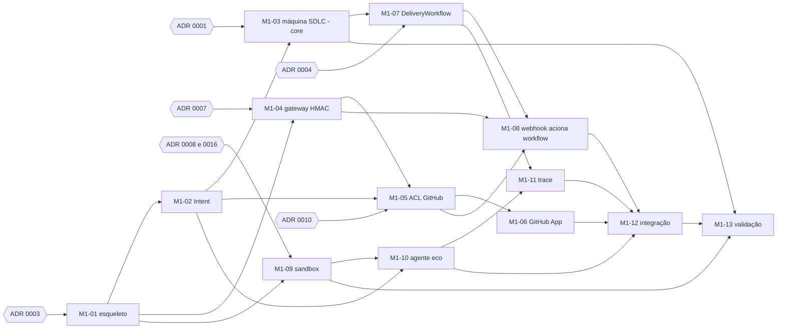

# agent-harness (Forja) · M1 Fundação: ordem de execução

**Escopo (design doc, seção 12):** domínio, FastAPI com webhooks verificados, GitHub App, Temporal, sandbox e trace ponta a ponta com um agente "eco".

**Critério de pronto proposto** (o design doc não traz um explícito; precisa de aprovação): um webhook assinado de issue com o label `forja:intent` inicia um `DeliveryWorkflow`; o agente eco roda num sandbox sem root, com arquivos restritos ao worktree e rede em allowlist; a resposta é publicada pelo workflow (o agente não publica); eventos repetidos não duplicam execução; a entrega aparece como um único trace; lint, tipos, testes e o teste de integração passam (M1-12, M1-13).

## ADRs que o M1 usa (status Proposto)

| ADR | Decisão | Bloqueia |
| --- | --- | --- |
| [0001](../adr/0001-sdlc-maquina-de-estados-com-artefatos.md) (F-01) | SDLC como máquina de estados com artefatos | M1-03 |
| [0003](../adr/0003-claude-agent-sdk-e-anthropic-sdk.md) (F-03) | Claude Agent SDK e SDK anthropic direto | M1-01, M1-10 |
| [0004](../adr/0004-temporal-orquestracao-duravel.md) (F-04) | Temporal para orquestração durável | M1-07 |
| [0007](../adr/0007-github-app-agente-nao-publica.md) (F-07) | GitHub App; o agente nunca publica | M1-04, M1-06 |
| [0008](../adr/0008-sandbox-efemero-egress-allowlist.md) (F-08) e [0016](../adr/0016-sandbox-isolamento-arquivos-e-rede.md) (F-16) | Sandbox efêmero, isolamento de arquivos e rede | M1-09 |
| [0010](../adr/0010-acl-github-sdk-observabilidade.md) (F-10) | ACL para GitHub, Agent SDK e observabilidade | M1-05, M1-10 |

Os ADRs 0002, 0005, 0006, 0009 e 0011 em diante pesam em marcos posteriores.

## Issues

| Id | Título | core | curso | Depende de | Estimativa |
| --- | --- | --- | --- | --- | --- |
| [M1-01](M1-01-esqueleto-e-ambiente-local.md) | Esqueleto do repositório e ambiente local | false | fc4-arch-hexagonal | ADR 0003 | 1 dia |
| [M1-02](M1-02-dominio-intent-e-intake.md) | Domínio: Intent, Origem e eventos de Intake | false | fc4-ddd-events | M1-01 | ½ dia |
| [M1-03](M1-03-dominio-maquina-de-estados-sdlc.md) | **Domínio: máquina de estados da Entrega** | **true** | fc4-ddd-events | M1-02, ADR 0001 | 1 dia |
| [M1-04](M1-04-gateway-webhooks-hmac-e-dedup.md) | Gateway FastAPI: webhooks com HMAC e deduplicação | false | fc4-sec-owasp-vault | M1-01, ADR 0007 | 1 dia |
| [M1-05](M1-05-acl-do-github-tradutores.md) | ACL do GitHub: tradutores de payload | false | fc4-arch-hexagonal | M1-02, M1-04, ADR 0010 | 1 dia |
| [M1-06](M1-06-github-app-e-cliente-de-escrita.md) | GitHub App: tokens de instalação e porta de escrita | false | fc4-sec-owasp-vault | M1-05, ADR 0007 | 1 dia |
| [M1-07](M1-07-temporal-delivery-workflow-esqueleto.md) | Temporal: `DeliveryWorkflow` esqueleto | false | un-4.6 | M1-01, M1-03, ADR 0004 | 1 dia |
| [M1-08](M1-08-webhook-aciona-workflow.md) | Do webhook ao workflow | false | un-4.7 | M1-04, M1-05, M1-07 | ½ dia |
| [M1-09](M1-09-sandbox-efemero-por-sessao.md) | Sandbox efêmero por sessão | false | fc4-tests-testcontainers | M1-01, ADRs 0008 e 0016 | 1 dia |
| [M1-10](M1-10-acl-agent-sdk-e-agente-eco.md) | ACL do Agent SDK e agente eco | false | un-4.1 | M1-02, M1-09, ADRs 0003 e 0010 | 1 dia |
| [M1-11](M1-11-trace-ponta-a-ponta.md) | Trace ponta a ponta e métricas | false | lt-tech-metrics | M1-07, M1-10 | 1 dia |
| [M1-12](M1-12-integracao-ponta-a-ponta.md) | Integração ponta a ponta | false | fc4-tests-testcontainers | M1-06, M1-08, M1-10, M1-11 | 1 dia |
| [M1-13](M1-13-validacao-m1.md) | Validação do critério de pronto | false | — | M1-03, M1-09, M1-12 | ½ dia |

## O que é core e o que não é

O núcleo do autor neste projeto (`plan.yaml`: `maquina-de-estados-sdlc`, `politica-de-risco-e-hooks`, `recuperacao-hibrida`; seção 14 do design doc) cai no M1, M5 e M2. **Só o M1-03 é core**: a máquina de estados da Entrega (`maquina-de-estados-sdlc`). Nele o agente escreve tipos, testes falhando e o roteiro em `docs/roteiros/maquina-de-estados-sdlc.md`, e para; o autor implementa as regras de transição. As demais issues são do agente. Política de risco e hooks (M5) e recuperação híbrida (M2) não têm issue no M1.

## Ordem e paralelismo

Ondas sugeridas (issues da mesma onda podem rodar em paralelo, em PRs separados):

1. M1-01.
2. M1-02, M1-04 e M1-09 (dependem só do M1-01).
3. M1-03 (core, com o autor), M1-05 e M1-10.
4. M1-06 e M1-07.
5. M1-08 e M1-11.
6. M1-12.
7. M1-13.

M1-03 é o caminho crítico para o `DeliveryWorkflow` (M1-07), então o autor deve começar o roteiro cedo.

## Pontos em aberto (precisam de decisão do autor)

- Critério de pronto do M1: o texto acima é uma proposta.
- Fórmula do id determinístico do Intent (M1-02) e valor de N ciclos Test/Build (M1-03).
- Langfuse ou Phoenix no compose do M1 (M1-11).
- Autenticação do botão de pânico (M1-08).
- Registro do GitHub App e guarda da chave privada (M1-06).
- Fundir ou não os ADRs 0008 e 0016 (M1-09).
